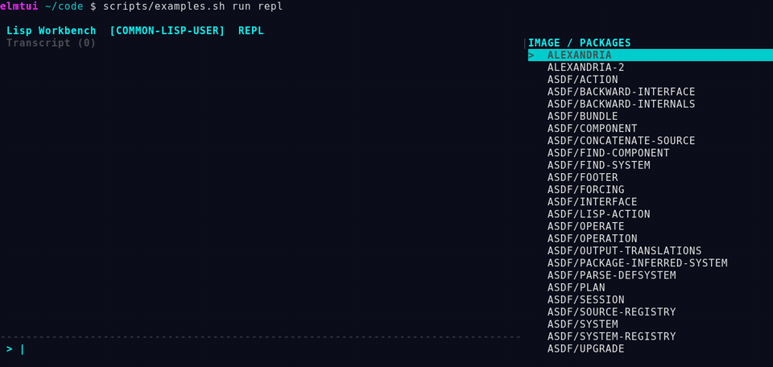

#+title: ElmTUI
#+subtitle: Elm-style terminal user interfaces for Common Lisp

ElmTUI brings the Elm architecture to Common Lisp terminal UIs. Describe your
interface as a declarative tree, transform state through messages, and let the
framework diff and render only what changed.  Model, update, view — the same
separation that makes Elm programs easy to reason about, applied to the terminal.

#+HTML: 

#+HTML: <table><tr>
#+HTML: <td width="50%"></td>
#+HTML: <td width="50%"></td>
#+HTML: </tr><tr>
#+HTML: <td align="center"><em>tmux-glider</em></td>
#+HTML: <td align="center"><em>neon-tetris</em></td>
#+HTML: </tr></table>

#+name: counter-example
#+begin_src lisp
(uiop:define-package :counter
  (:use :cl)
  (:import-from :elmtui
                #:defapplication #:make-update-result #:state-ref
                #:key-pressed-p #:quit-requested-p)
  (:export #:run-counter))
(in-package :counter)

(defun initial-state ()
  (list :count 0 :should-quit nil))

(defun update (message state)
  (let ((count (state-ref state :count 0)))
    (cond
      ((key-pressed-p message :char #\+)
       (make-update-result :patches `(((:count) ,(1+ count)))))
      ((key-pressed-p message :char #\-)
       (make-update-result :patches `(((:count) ,(1- count)))))
      ((or (key-pressed-p message :char #\q) (quit-requested-p message))
       (make-update-result :patches '(((:should-quit) t))))
      (t (make-update-result)))))

(defun view (state)
  `(:container
    :id :root
    :style (:display :block :width 34 :height 3 :padding 1)
    :children
    ((:text :id :count
      :content ,(format nil "Count: ~D   (+/- change, q quits)"
                        (state-ref state :count 0))))))

(defapplication counter
  :root-component-dsl '(:root-viewport :id :counter-root
                        :anchor :below-cursor :height 3
                        :child-dsl-spec (:view nil))
  :root-viewport-id :counter-root
  :initial-state-fn #'initial-state
  :update-fn #'update
  :view-fn #'view)
#+end_src

* Status

#+HTML: 
#+HTML: 

The latest release is [[https://github.com/fkr-0/elmtui/releases/tag/v0.4.0][0.4.0]]. It is qualified on SBCL on
POSIX terminals; other Common Lisp implementations are not yet supported,
because parts of the toolkit use SB-POSIX and SB-MOP. ElmTUI is pre-1.0:
minor versions may change the API (see the [[file:CHANGELOG.md][changelog]]), and
[[file:docs/reviews/api-review-20261101.md][the API review]] lists the known problems with the exported API and
their fixes.

The coverage badge shows SB-COVER expression coverage of the primary =elmtui=
system. CI publishes it only from a fully green release gate on =main=;
=scripts/run-coverage-warning-clean.sh= produces the same figure and a
per-file report locally (see
[[file:docs/reviews/coverage-improvement-20261026.md][coverage qualification evidence]]).

* Quickstart

You need SBCL, [[https://www.clpm.dev/][CLPM]], git, and a terminal with ANSI support. tmux is
optional.

** Install

#+begin_src sh
git clone --recurse-submodules https://github.com/fkr-0/elmtui.git
cd elmtui
clpm bundle install
#+end_src

Run the commands below from the repository root; the CLPM bundle makes the
ElmTUI systems and their dependencies visible to ASDF.

** Try the examples

#+begin_src sh
scripts/examples.sh list
scripts/examples.sh run neon-tetris   # A/D move, W rotate, S drop, Q quits
scripts/examples.sh run repl          # the Lisp Workbench; Ctrl-D quits
#+end_src

** Your first application

Save this as =counter.lisp=:

#+name: quickstart-counter
#+begin_src lisp
(uiop:define-package :counter
  (:use :cl)
  (:import-from :elmtui
                #:defapplication #:make-update-result #:state-ref
                #:key-pressed-p #:quit-requested-p)
  (:export #:run-counter))
(in-package :counter)

(defun initial-state ()
  (list :count 0 :should-quit nil))

(defun update (message state)
  "Return the state changes MESSAGE causes, as patches."
  (let ((count (state-ref state :count 0)))
    (cond
      ((key-pressed-p message :char #\+)
       (make-update-result :patches `(((:count) ,(1+ count)))))
      ((key-pressed-p message :char #\-)
       (make-update-result :patches `(((:count) ,(1- count)))))
      ((or (key-pressed-p message :char #\q) (quit-requested-p message))
       (make-update-result :patches '(((:should-quit) t))))
      (t (make-update-result)))))

(defun view (state)
  `(:container
    :id :root
    :style (:display :block :width 34 :height 3 :padding 1)
    :children
    ((:text :id :count
      :content ,(format nil "Count: ~D   (+/- change, q quits)"
                        (state-ref state :count 0))))))

(defapplication counter
  :root-component-dsl '(:root-viewport :id :counter-root
                        :anchor :below-cursor :height 3
                        :child-dsl-spec (:view nil))
  :root-viewport-id :counter-root
  :initial-state-fn #'initial-state
  :update-fn #'update
  :view-fn #'view)
#+end_src

Run it:

#+begin_src sh
clpm bundle exec --with-client sbcl -- --noinform --non-interactive \
  --eval '(require :asdf)' --eval '(asdf:load-system "elmtui")' \
  --load counter.lisp --eval '(counter:run-counter)'
#+end_src

How it fits together:

- =initial-state= returns the model, a plist.
- =update= receives each message and the current state. It never changes
  the state itself; it returns =make-update-result= with /patches/, pairs of
  a state path and a new value, which the runtime applies. =key-pressed-p=
  matches key presses (by =:char=, =:key= such as =:up=, and =:modifiers=);
  =quit-requested-p= recognises Ctrl-C. Setting =:should-quit= ends the
  application.
- =view= is a pure function from state to a declarative UI tree
  (=:container=, =:text=, …) with CSS-like styles.
- =defapplication= wires them together and defines =run-counter=. The
  root =elmtui= package exports the application API; extension and backend
  APIs live in the =elmtui.ui.*=, =elmtui.state.*= and =elmtui.platform.*=
  packages. The root
  viewport is drawn below the cursor and needs an explicit =:height=.
  Framework logging is off while the application runs; pass
  =:log-file "counter.log"= to =run-counter= to keep it.

=defapplication= uses patch-based state updates. For a simpler
model-replacement style closer to canonical Elm/TEA, use =deftea-app=:

#+begin_src lisp
(deftea-app counter
  :init       #'init        ; () → (values model commands)
  :transition #'transition  ; (msg model) → (values next-model commands)
  :view       #'view-fn)    ; model → dsl-tree
#+end_src

=transition= receives and returns the model directly instead of patches;
Ctrl-C quits by default. =deftea-app= wraps into =defapplication= under the
hood, so the same runtime drives both.

Next steps: the [[file:docs/longform/01-foundations-and-elm-architecture.md][foundations]] chapter explains the architecture,
[[file:docs/longform/02-core-principles-widgets-and-patterns.md][widgets and patterns]] covers layout, widgets and effects, the
[[file:examples/README.md][examples]] show complete applications, and the
[[https://elmtui.fkr.dev/][documentation site]] has the generated API reference.

** Development setup

The main =clpmfile= contains only runtime and test dependencies. SLY/Slynk is
kept in =dev/clpmfile= and installed by the =bridge.yml= =slynk= command.
To run the test suites and the release gate, see [[*Testing][Testing]].

* ElmTUI Workbench — flagship release example

The separately loadable Workbench brings an interactive Common Lisp REPL,
multiline editor, completion menu, selected-symbol documentation, and an
image/package inspector into a terminal UI. It exercises the framework's
message-driven state, asynchronous effects, incremental renderer and terminal
lifecycle. Workbench evaluation is trusted, in-process Common Lisp — not a
sandbox — and Slynk is optional rather than a core runtime requirement.

#+begin_src sh
scripts/examples.sh run repl
#+end_src

See the [[file:docs/workbench-user-guide.md][Workbench user guide]]. The recordings below are real
sessions of the maintained examples; more are on [[https://elmtui.fkr.dev/][the project website]].

* What ElmTUI provides

- Elm/TEA-style application flow: model, message, update, view, effects.
- Declarative terminal UI trees and component DSLs.
- Flex, grid, viewport, focus, keymap, and inline scrolling behavior.
- Normal-screen/below-cursor terminal ownership; synchronous scroll acknowledgements
  are processed before presenting the affected frame (no alternate-screen
  requirement).
- Diffed virtual-buffer rendering with terminal and fake-terminal backends.
- Typed terminal input decoding and event routing.
- Transactional state updates with observers and undo/redo.
- CSS-like selector, cascade, variable, and property handling.
- Maintained interactive examples and a standalone image packager.

** Effects and asynchronous commands

The =update= (or =transition=) function can return /commands/ alongside state
changes.  Commands are asynchronous operations whose results re-enter the
message loop.  The primary constructor is =cmd-async=:

#+begin_src lisp
(cmd-async #'fetch-weather
  :args '("Berlin")
  :on-complete (lambda (result) `(:weather-arrived :data ,result))
  :on-error    (lambda (condition) `(:weather-failed :err ,condition))
  :timeout     10)
#+end_src

With =defapplication=, return commands through =make-update-result=:

#+begin_src lisp
(make-update-result :patches `(((:loading) t))
                    :commands (list (cmd-async ...)))
#+end_src

With =deftea-app=, return them as the second value from =transition=:

#+begin_src lisp
(defun transition (msg model)
  (values (list* :loading t model)
          (list (cmd-async ...))))
#+end_src

Also available: =cmd-async-with-retry=, =cmd-recurring=, =cmd-batch=, and
=cmd-batch-await=.  The =async-weather= example demonstrates the full
pattern.  See [[file:docs/longform/02-core-principles-widgets-and-patterns.md][widgets and patterns]] for the complete effects API.

** Custom widgets

=defcomponent= defines reusable widgets with their own local state, message
handlers and view function:

#+begin_src lisp
(defcomponent my-label ()
  (:state (text "" :type string)
          (style nil))
  (:init (props self-id-path)
    (list :text (getf props :text "")))
  (:update (message local-state app-state self-id-path)
    (:set-text (new-text)
      (values `(((:text) ,new-text)) nil)))
  (:view (local-state app-state self-id-path children)
    `(:text :id :label
      :content ,(getf local-state :text)
      :style ,(getf local-state :style))))
#+end_src

Update handlers use keyword dispatch and return =(values patches commands)=.
Shipped widgets (=label=, =scroll-panel=, =button-enhanced=, …) are built
the same way.  See [[file:docs/longform/02-core-principles-widgets-and-patterns.md][widgets and patterns]] for the component contract.

** Standalone binaries

=elmtui-packager= builds self-contained SBCL executables from any ElmTUI
application.  No CLPM, ASDF, or source tree needed at runtime.

#+begin_src sh
# Build the packager tool itself (once):
clpm bundle exec --with-client sbcl -- --noinform --non-interactive \
  --eval '(require :asdf)' --eval '(asdf:make :elmtui-packager)'

# Package an example as a standalone binary:
./elmtui-packager -s elmtui-examples \
  -E elmtui.examples.minimal:run-minimal -o ./minimal

# Run it anywhere — no Lisp toolchain required:
./minimal
#+end_src

Flags:

| Flag | Short | Description |
|------+-------+-------------|
| =--system= | =-s= | ASDF system(s) to load before dumping (repeatable) |
| =--file= | =-f= | Lisp file(s) to load before dumping (repeatable) |
| =--eval= | =-e= | Form(s) to evaluate before dumping (repeatable) |
| =--entry= | =-E= | Entry function for the image, e.g. =my-app:run= (required) |
| =--output= | =-o= | Output binary path (required) |

SBCL with =:sb-core-compression= compresses the image automatically (zstd,
level 9).  The packager requires SBCL; other implementations are not yet
supported.

** Tmux integration

ElmTUI auto-detects tmux and captures the styled visible-pane content to
prefill the virtual buffer, so applications render as overlays atop existing
terminal content.  The contract:

- Normal screen only — the alternate screen is never used.
- Scrollback is preserved; the terminal is restored exactly on exit.
- Resize events are handled as transactions.
- No idle writes; only changed cells are painted.

No special user setup is needed — run your application inside tmux and the
framework handles the rest.  The platform API (=tmux-available-p=,
=capture-pane-string=, =capture-screen-string=) is in the
=elmtui.platform.*= packages.

* Repository systems

The repository intentionally separates reusable mechanics from terminal UI
policy.

| ASDF system | Responsibility | License |
|-------------+----------------+---------|
| =cl-events= | Channels, event types, pub/sub, async tasks, generic loop mechanics | MIT |
| =cl-inputs= | Byte decoding, keymaps, input tokens, device and sink ports | MIT |
| =cl-state= | Paths, containers, patches, transactions, observers, validation | MIT |
| =cl-styles= | Selectors, rules, cascade, variables, property normalization | MIT |
| =elmtui= | Components, UI DSL, runtime policy, rendering, terminal integration | MIT |
| =elmtui-examples= | Maintained example applications | MIT |
| =elmtui-packager= | Standalone executable/image packaging | MIT |
| =elmtui-dev= | Optional runtime diagnostics, native view previews and microbenchmarks | MIT |
| =elmtui-workbench= | Optional interactive Lisp workbench, rendered through ElmTUI | MIT |
| =elmtui-example-widgets= | Optional demonstration components | MIT |

The complete ownership rules are documented in
[[file:docs/architecture/library-boundaries.md][docs/architecture/library-boundaries.md]].
For developer utility APIs, runnable examples and limitations, see
[[file:docs/developer-tools.md][the developer tools guide]].

* Documentation website

The documentation site at [[https://elmtui.fkr.dev/][elmtui.fkr.dev]] is built with MkDocs Material from a curated set of
public sources; publishing is managed by =.github/workflows/pages.yml=. For
local preview (after installing MkDocs Material in your environment):

#+begin_src sh
python3 scripts/prepare-site.py
python3 -m mkdocs build --strict
python3 -m mkdocs serve
#+end_src

The site media are recorded from real example sessions by
=scripts/record-demo-media.py=; see [[file:website/assets/README.md][website/assets/README.md]].

* Documentation

The long-form documentation is deliberately ordered from architecture to
practice:

1. [[file:docs/longform/01-foundations-and-elm-architecture.md][Foundations: Elm architecture in Common Lisp]] explains the TEA runtime,
   quotes the actual model-replacement and mutable-state source paths, and
   states precisely where strict Elm-style immutability does and does not hold.
2. [[file:docs/longform/02-core-principles-widgets-and-patterns.md][Core principles, widgets, and patterns]] covers program parts, state/effect
   ownership, conditions/restarts, polling, terminal UX, built-in widgets, and
   widget-authoring contracts.
3. [[file:docs/longform/03-hands-on-counter-and-async.md][Hands-on counter and async lookup]] builds a pure replacement-model counter
   and extends the same architecture to a request-id-safe asynchronous
   Wikipedia-style lookup.

API reference pages are generated from live Common Lisp =DOCUMENTATION=
metadata rather than being maintained as a second handwritten API source:

#+begin_src sh
scripts/build-api-docs.sh
#+end_src

The generated outputs are =docs/api/generated/api.md= and
=docs/api/generated/api.html=.  The public-documentation audit is:

#+begin_src sh
scripts/check-docstrings.sh
#+end_src

The default audit is a debt ratchet: it fails if public documentation coverage
regresses. For 0.4.0 it passes at 90.3% coverage
(1,840 documented-or-missing bindings; 178 missing docstrings). This is not the
same as complete API documentation.  To require every supported exported binding to have documentation
metadata, use the strict target:

#+begin_src sh
ELMTUI_DOCSTRING_STRICT=1 scripts/check-docstrings.sh
#+end_src

The same operations are exposed as the =bridge.yml= commands =docs=,
=doc-audit=, and =doc-audit-strict=.  The non-regression audit also runs as part
of =scripts/release-check.sh=. For the interpretation of audit counts, the
source-verified terminal-style and contract APIs, and regression-test coverage,
see [[file:docs/api/README.md][the API documentation and verification guide]].

* Running examples

Load the maintained examples and start one by calling its exported runner:

#+begin_src sh
clpm bundle exec --with-client sbcl -- \
  --noinform \
  --eval '(require :asdf)' \
  --eval '(asdf:load-system "elmtui-examples")' \
  --eval '(elmtui.examples.minimal:run-minimal)'
#+end_src

See [[file:examples/README.md][examples/README.md]] for the curated example map and
entry points.  Command-line example discovery/building is intentionally outside
the core =elmtui= system: =./scripts/examples.sh list= loads the dedicated
=elmtui-examples-cli= ASDF system.  Image packaging similarly lives in
=elmtui-packager=, so loading =elmtui= alone does not intern either CLI package.

* Testing

Run the root integration suite:

#+begin_src sh
clpm bundle exec --with-client sbcl -- \
  --noinform --load scripts/run-tests-clpm.lisp
#+end_src

Run every reusable subsystem independently:

#+begin_src sh
scripts/test-subsystems.sh
#+end_src

Run the complete release gate:

#+begin_src sh
scripts/release-check.sh
#+end_src

The release gate checks repository topology, the tracked release manifest,
staged and unstaged patch whitespace, all four independent support-library
suites, and the warning-clean full ElmTUI suite.

The tmux capture checks need no setup: they start and remove their own private
tmux server, so they run the same inside or outside a tmux session.  They
require the =tmux= binary and fail, rather than skip, if it is missing.

* Source layout

#+begin_example
elmtui.lisp/
├── cl-events/          Git submodule: reusable event/runtime mechanics
├── cl-inputs/          Git submodule: reusable terminal input subsystem
├── cl-state/           Git submodule: reusable state subsystem
├── cl-styles/          Git submodule: reusable style subsystem
├── src/
│   ├── app/            application definition and TEA runtime policy
│   ├── core/           ElmTUI event adapters, contracts, errors, globals
│   ├── platform/       input integration, rendering backends, tmux helpers
│   ├── state/          ElmTUI state/update adapters
│   ├── style/          renderer-facing style adapters and presets
│   ├── ui/             components, widgets, focus, layout, DSL
│   └── view/           view tree, reactivity, layout and rendering stages
├── examples/           maintained applications
├── tests/              root unit, integration, regression, and smoke tests
├── docs/               architecture and release documentation
└── scripts/            reproducible verification commands
#+end_example

The four =cl-*= libraries are real Git submodules.  ElmTUI pins each standalone
library to an exact commit while the libraries retain independent histories and
release identities.  Clone with =--recurse-submodules=, or initialize an existing
checkout with =git submodule update --init --recursive=.

* Design constraints

- Reusable =cl-= systems must not depend on =elmtui= packages.
- ElmTUI may adapt or re-export a support-library API, but must not carry a
  second implementation of the same generic mechanism.
- Terminal/UI policy remains in =src/=, even when it delegates transport,
  state, event, or style mechanics to a support library.
- Compatibility adapters must be thin and covered by integration tests.
- Each support library must remain loadable and testable through its own ASDF
  system.

* Release information

- [[file:CHANGELOG.md][CHANGELOG.md]] records release-visible changes.
- Releases are tagged only on commits that pass =scripts/release-check.sh= in CI.
- Releases and their notes: [[https://github.com/fkr-0/elmtui/releases][github.com/fkr-0/elmtui/releases]].  The four reusable
  libraries are published independently under the same GitHub account.
  Signed release artifacts are not provided yet.

* License

ElmTUI and its reusable =cl-events=, =cl-inputs=, =cl-state=, and
=cl-styles= libraries are licensed under MIT.  See the root =LICENSE= and
each library’s own =LICENSE= file. 
