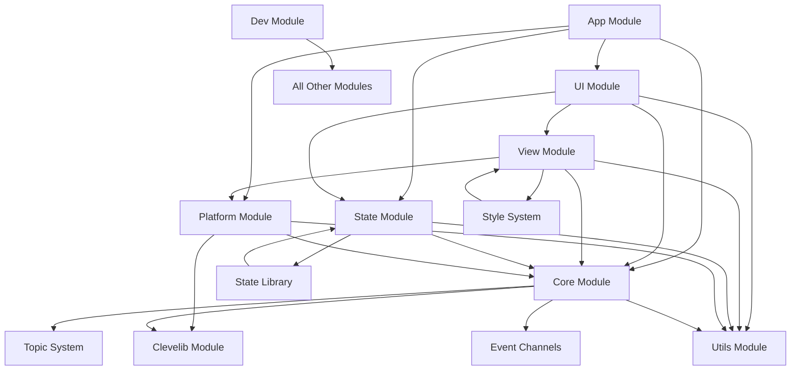

---
# AI Metadata Tags
ai_keywords: [Dependency Analysis, Module Coupling, API Boundaries, Architectural Refactoring, Circular Dependencies, Interface Design, Modularity, System Decoupling]
ai_contexts: [architecture, development, implementation]
ai_relations: [
  "./module-dependencies.md",
  "./system-overview.md",
  "./api-organization.md",
  "../modules/app/overview.md",
  "../modules/core/overview.md",
  "../modules/state/overview.md",
  "../modules/ui/overview.md",
  "../modules/view/overview.md",
  "../modules/platform/overview.md",
  "../modules/clevelib/overview.md"
]
---

# Elmtui Module Dependency Analysis and API Refactoring Plan

<!-- AI-IMPORTANCE:level=critical -->
## Executive Summary

This document provides a thorough analysis of current module dependencies in Elmtui and presents a comprehensive plan to reduce coupling by establishing clear API boundaries. The current architecture shows significant interdependencies that can be simplified through proper interface design and dependency inversion.

## Current Dependency Analysis

<!-- AI-CONTEXT-START:type=architecture -->
### Actual Dependencies (Based on Code Analysis)

Based on examination of the ASDF system definition and API files, the current dependencies are:

#### High-Level Module Dependencies


#### File-Level Dependencies (Critical Issues)

**Circular Dependencies Identified:**
1. **View ↔ UI Cycle:** View system depends on UI components, UI components use View DSL
2. **Core ↔ State Cycle:** Core manages state updates, State uses Core for event handling
3. **Platform ↔ View Cycle:** Platform renders View trees, View uses Platform capabilities

**Cross-Cutting Concerns:**
1. **Utils Module:** Used by virtually every other module (acceptable utility dependency)
2. **Dev Module:** Instruments all modules for debugging (development-only concern)
3. **Event System:** Spans Core, State, UI, and App modules

### Problematic Dependencies

#### 1. Direct Implementation Dependencies
```
src/ui/defcomponent.lisp → src/state/elm.lisp
src/view/dsl.lisp → src/ui/widgets/*.lisp
src/platform/driver.lisp → src/app/application.lisp
```

#### 2. Shared State Access
```
Multiple modules directly accessing:
- Global state variables
- Event queues
- Focus management state
```

#### 3. Tightly Coupled Subsystems
```
Style System (spread across View/Platform/UI)
Event System (spread across Core/State/UI/App)
Component System (spread across UI/View/State)
```
<!-- AI-CONTEXT-END -->

## Target Architecture: API-Driven Design

<!-- AI-CONTEXT-START:type=implementation -->
### Proposed API Boundaries

#### 1. Core Public APIs
```lisp
;; elmtui.core.api - Main Core Interface
(defpackage #:elmtui.core.api
  (:use #:cl)
  (:export
   ;; Event Loop Control
   #:start-event-loop
   #:stop-event-loop
   #:submit-event
   
   ;; Focus Management
   #:request-focus
   #:get-focused-component
   #:focus-next
   #:focus-previous
   
   ;; Message Bus
   #:register-topic
   #:subscribe-topic
   #:publish-message
   #:create-channel
   
   ;; Async Operations
   #:submit-async-task
   #:create-timer))
```

#### 2. State Management APIs
```lisp
;; elmtui.state.api - State Management Interface
(defpackage #:elmtui.state.api
  (:use #:cl)
  (:export
   ;; TEA Pattern
   #:defmodel
   #:defmsg
   #:defupdate
   
   ;; State Operations
   #:get-app-state
   #:update-app-state
   #:get-component-state
   #:update-component-state
   
   ;; Transactions
   #:with-transaction
   #:commit-transaction
   #:rollback-transaction
   
   ;; Observation
   #:observe-state
   #:unobserve-state))
```

#### 3. UI Component APIs
```lisp
;; elmtui.ui.api - Component Interface
(defpackage #:elmtui.ui.api
  (:use #:cl)
  (:export
   ;; Component Definition
   #:defcomponent
   #:component-props
   #:component-state
   #:send-message
   
   ;; Standard Widgets
   #:button
   #:label
   #:textinput
   #:viewport
   #:grid-container
   
   ;; Lifecycle
   #:mount-component
   #:unmount-component
   #:update-component))
```

#### 4. View Rendering APIs
```lisp
;; elmtui.view.api - View DSL Interface
(defpackage #:elmtui.view.api
  (:use #:cl)
  (:export
   ;; Layout Primitives
   #:vertical-layout
   #:horizontal-layout
   #:grid-layout
   #:flex-layout
   
   ;; Styling
   #:with-style
   #:apply-theme
   
   ;; Rendering
   #:render-view-tree
   #:diff-view-trees))
```

#### 5. Platform Abstraction APIs
```lisp
;; elmtui.platform.api - Platform Interface
(defpackage #:elmtui.platform.api
  (:use #:cl)
  (:export
   ;; Backend Management
   #:initialize-backend
   #:cleanup-backend
   #:get-terminal-size
   
   ;; Input/Output
   #:read-input-event
   #:write-output
   #:clear-screen
   
   ;; Capabilities
   #:supports-colors-p
   #:supports-mouse-p))
```

### Dependency Inversion Strategy

#### 1. Interface Segregation
Each module will expose only the minimum necessary interface:

```lisp
;; Instead of direct access to internal structures
(core::*current-focus*)

;; Use controlled API access
(elmtui.core.api:get-focused-component)
```

#### 2. Event-Driven Communication
Replace direct method calls with message passing:

```lisp
;; Instead of direct calls
(state::update-global-state new-state)

;; Use message-based updates
(elmtui.core.api:publish-message 
  :state-update 
  (make-state-update-msg :new-state new-state))
```

#### 3. Dependency Injection
Use protocol-based design for pluggable components:

```lisp
;; Platform backend protocol
(defprotocol platform-backend
  (initialize (backend))
  (read-input (backend))
  (write-output (backend output)))

;; Multiple implementations
(defclass terminal-backend () ...)
(defclass mock-backend () ...)
```
<!-- AI-CONTEXT-END -->

## Refactoring Plan

<!-- AI-CONTEXT-START:type=development -->
### Phase 1: API Definition and Interface Contracts

**Timeline:** 2-3 weeks
**Scope:** Define all public APIs without breaking existing code

#### 1.1 Create API Package Definitions
- [ ] `elmtui.core.api` - Core services interface
- [ ] `elmtui.state.api` - State management interface
- [ ] `elmtui.ui.api` - Component and widget interface
- [ ] `elmtui.view.api` - View DSL and rendering interface
- [ ] `elmtui.platform.api` - Platform abstraction interface

#### 1.2 Establish Interface Contracts
- [ ] Define protocol classes for major abstractions
- [ ] Create comprehensive API documentation
- [ ] Establish versioning strategy for APIs

#### 1.3 Backward Compatibility Layer
- [ ] Create compatibility shims for existing code
- [ ] Gradual migration path for internal usage
- [ ] Deprecation warnings for internal API usage

### Phase 2: Core System Decoupling

**Timeline:** 3-4 weeks
**Scope:** Break circular dependencies in core systems

#### 2.1 Event System Refactoring
```lisp
;; Current: Direct state manipulation
(defun handle-input-event (event)
  (let ((component (core::get-focused-component)))
    (state::update-component-state component ...)))

;; Target: Message-driven approach
(defun handle-input-event (event)
  (elmtui.core.api:publish-message 
    :component-input
    (make-input-msg :component (elmtui.core.api:get-focused-component)
                    :event event)))
```

#### 2.2 State Management Isolation
- [ ] Move all state access through `elmtui.state.api`
- [ ] Implement observer pattern for state changes
- [ ] Remove direct state manipulation from non-State modules

#### 2.3 View System Independence
- [ ] Separate view DSL from component implementation
- [ ] Create abstract renderer interface
- [ ] Platform-agnostic view tree representation

### Phase 3: Module Interface Enforcement

**Timeline:** 2-3 weeks
**Scope:** Enforce API boundaries through package structure

#### 3.1 Package Restructuring
```lisp
;; Current structure allows internal access
(defpackage #:elmtui.core
  (:use #:cl #:elmtui.utils #:elmtui.clevelib)
  (:export #:*current-focus* #:event-queue ...))

;; Target structure with clean separation
(defpackage #:elmtui.core.internal
  (:use #:cl #:elmtui.utils #:elmtui.clevelib))

(defpackage #:elmtui.core.api
  (:use #:cl)
  (:import-from #:elmtui.core.internal ...)
  (:export #:get-focused-component #:submit-event ...))
```

#### 3.2 Symbol Access Control
- [ ] Move implementation symbols to `*.internal` packages
- [ ] Export only API symbols from main packages
- [ ] Add package documentation and usage guidelines

#### 3.3 Testing Interface Boundaries
- [ ] Create integration tests that only use public APIs
- [ ] Validate that modules can be loaded independently
- [ ] Performance testing of API overhead

### Phase 4: Advanced Architectural Patterns

**Timeline:** 3-4 weeks
**Scope:** Implement advanced patterns for loose coupling

#### 4.1 Plugin Architecture
```lisp
;; Extensible component system
(defprotocol ui-component
  (render (component props state))
  (handle-event (component event))
  (get-initial-state (component props)))

;; Plugin registration
(elmtui.ui.api:register-component 'custom-widget custom-widget-class)
```

#### 4.2 Dependency Injection Container
```lisp
;; Service registration
(elmtui.core.api:register-service :state-manager state-manager-impl)
(elmtui.core.api:register-service :event-bus event-bus-impl)

;; Service resolution
(defmacro with-services ((&rest services) &body body)
  ...)
```

#### 4.3 Event Sourcing for State Management
- [ ] Implement event sourcing for state changes
- [ ] Create replay capability for debugging
- [ ] Add state snapshots for performance

### Phase 5: Documentation and Migration

**Timeline:** 1-2 weeks
**Scope:** Complete documentation and migration support

#### 5.1 API Documentation
- [ ] Complete API reference documentation
- [ ] Create migration guides for existing code
- [ ] Example applications using only public APIs

#### 5.2 Performance Validation
- [ ] Benchmark API overhead vs direct access
- [ ] Optimize critical paths
- [ ] Performance regression testing

#### 5.3 Final Migration
- [ ] Remove all internal API usage
- [ ] Clean up deprecated compatibility layers
- [ ] Final architecture validation
<!-- AI-CONTEXT-END -->

## Benefits of API-Driven Architecture

### 1. Improved Modularity
- **Clear Boundaries:** Well-defined interfaces between modules
- **Independent Development:** Modules can be developed and tested in isolation
- **Easier Testing:** Mock implementations for testing individual components

### 2. Enhanced Maintainability
- **Reduced Coupling:** Changes in one module don't break others
- **Version Management:** API versioning enables gradual upgrades
- **Documentation:** Self-documenting interfaces

### 3. Better Extensibility
- **Plugin System:** Third-party extensions through stable APIs
- **Alternative Implementations:** Different backends/frontends using same APIs
- **Configuration:** Runtime selection of implementations

### 4. Performance Benefits
- **Optimization Opportunities:** Internal implementations can be optimized without API changes
- **Caching:** API layer can implement intelligent caching
- **Lazy Loading:** Modules loaded only when needed

## Risk Mitigation

### 1. API Design Risks
- **Over-abstraction:** Keep APIs practical and usable
- **Performance Overhead:** Minimize API call overhead in critical paths
- **Complexity:** Balance flexibility with simplicity

### 2. Migration Risks
- **Breaking Changes:** Maintain backward compatibility during transition
- **Development Velocity:** Staged migration to avoid disrupting development
- **Testing Gaps:** Comprehensive testing during each migration phase

### 3. Maintenance Risks
- **API Evolution:** Clear versioning and deprecation policies
- **Documentation Drift:** Automated documentation generation where possible
- **Performance Regression:** Continuous performance monitoring

## Success Metrics

### 1. Coupling Metrics
- **Fan-in/Fan-out:** Measure module dependencies before/after
- **Cyclic Dependencies:** Eliminate all circular dependencies
- **Interface Stability:** Track API changes over time

### 2. Development Metrics
- **Build Time:** Independent module compilation
- **Test Isolation:** Percentage of tests that can run in isolation
- **Documentation Coverage:** API documentation completeness

### 3. Quality Metrics
- **Bug Locality:** Bugs contained within module boundaries
- **Feature Velocity:** Speed of adding new features
- **Code Reuse:** Shared functionality through stable APIs

## Related Resources

- [Module Dependencies Overview](./module-dependencies.md)
- [System Architecture Overview](./system-overview.md)
- [API Organization Guide](./api-organization.md)
- [App Module Overview](../modules/app/overview.md)
- [Core Module Overview](../modules/core/overview.md)
- [State Module Overview](../modules/state/overview.md)
- [UI Module Overview](../modules/ui/overview.md)
- [View Module Overview](../modules/view/overview.md)
- [Platform Module Overview](../modules/platform/overview.md)

---
*This analysis will be updated as the refactoring progresses and new architectural insights are discovered.*