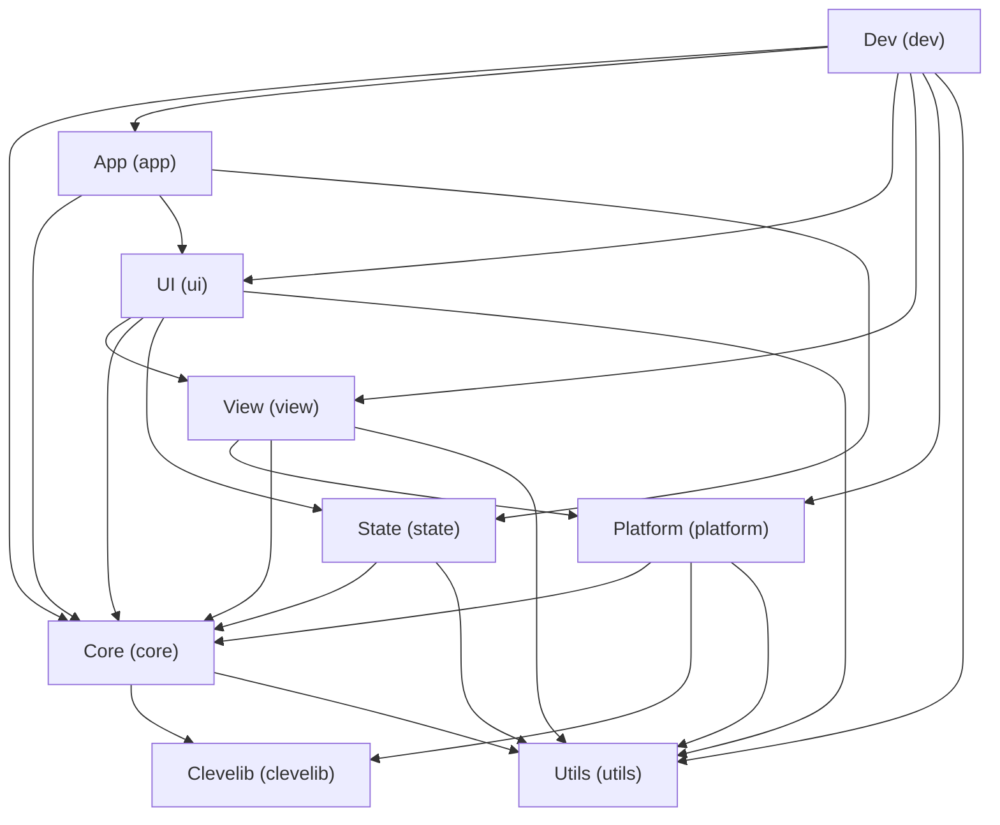

---
# AI Metadata Tags
ai_keywords: [Module Dependencies, Elmtui Interactions, Dependency Graph, System Interactions, Application Initialization, UI Rendering Flow, Event Handling Flow, Styling Flow, Low-level Access, Utility Usage]
ai_contexts: [architecture]
ai_relations: [
  "./system-overview.md",
  "./core-concepts.md",
  "../modules/app/overview.md",
  "../modules/clevelib/overview.md",
  "../modules/core/overview.md",
  "../modules/dev/overview.md",
  "../modules/platform/overview.md",
  "../modules/state/overview.md",
  "../modules/ui/overview.md",
  "../modules/utils/overview.md",
  "../modules/view/overview.md",
  "../ai-index/overview.md"
]
---
# Elmtui Module Dependencies and Interactions

This document outlines how the core modules of Elmtui depend on each other and interact to provide the overall functionality of the library.

## Core Modules Overview

The primary modules (based on `src/` subdirectories and the documentation structure) are:
*   [App (`app`)](../modules/app/overview.md)
*   [Clevelib (`clevelib`)](../modules/clevelib/overview.md)
*   [Core (`core`)](../modules/core/overview.md)
*   [Dev (`dev`)](../modules/dev/overview.md)
*   [Platform (`platform`)](../modules/platform/overview.md)
*   [State (`state`)](../modules/state/overview.md)
*   [UI (`ui`)](../modules/ui/overview.md)
*   [Utils (`utils`)](../modules/utils/overview.md)
*   [View (`view`)](../modules/view/overview.md)

## Dependency Graph / Diagram

(A Mermaid diagram or similar visual representation will be inserted here to illustrate dependencies. For example:)

*(The above diagram is a representation based on the current understanding and needs to be refined based on detailed code analysis of actual project dependencies.)*

## Key Interaction Patterns

### 1. Application Initialization ([`app`](../modules/app/overview.md) -> [`core`](../modules/core/overview.md), [`ui`](../modules/ui/overview.md), [`state`](../modules/state/overview.md))
*   The [`app`](../modules/app/overview.md) module typically initializes the [`core`](../modules/core/overview.md) event loop, sets up the initial [`state`](../modules/state/overview.md), and renders the root [`ui`](../modules/ui/overview.md) component.

### 2. UI Rendering ([`ui`](../modules/ui/overview.md) -> [`view`](../modules/view/overview.md) -> [`platform`](../modules/platform/overview.md))
*   [`ui`](../modules/ui/overview.md) components define their structure using the [`view`](../modules/view/overview.md) DSL.
*   The [`view`](../modules/view/overview.md) system processes this structure, performs layout and styling.
*   The [`platform`](../modules/platform/overview.md) module takes the processed view tree and renders it to the terminal.

### 3. Event Handling ([`platform`](../modules/platform/overview.md) -> [`core`](../modules/core/overview.md) -> [`ui`](../modules/ui/overview.md) -> [`state`](../modules/state/overview.md) -> [`app`](../modules/app/overview.md))
*   [`platform`](../modules/platform/overview.md) captures raw input events from the terminal.
*   [`core`](../modules/core/overview.md) processes these events, manages focus, and dispatches them.
*   [`ui`](../modules/ui/overview.md) components handle relevant events and may generate messages.
*   Messages are processed by the [`state`](../modules/state/overview.md) update logic, potentially modifying the application model.
*   Changes in the [`state`](../modules/state/overview.md) (model) trigger a re-render, starting the UI rendering cycle again. The [`app`](../modules/app/overview.md) might coordinate this.

### 4. Styling (Handled within [`view`](../modules/view/overview.md) and [`platform`](../modules/platform/overview.md))
*   Styling rules and properties (colors, text attributes) are defined and applied as part of the [`view`](../modules/view/overview.md) DSL.
*   The [`view`](../modules/view/overview.md) system, in conjunction with the [`platform`](../modules/platform/overview.md) module, translates these styles into terminal-specific output.

### 5. Development Tools ([`dev`](../modules/dev/overview.md) -> various)
*   The [`dev`](../modules/dev/overview.md) module provides tools that may inspect or interact with [`core`](../modules/core/overview.md) systems, [`ui`](../modules/ui/overview.md) elements, [`view`](../modules/view/overview.md) trees, or [`platform`](../modules/platform/overview.md) backends for debugging and monitoring.

### 6. Low-Level Access ([`clevelib`](../modules/clevelib/overview.md) as a provider)
*   Modules like [`platform`](../modules/platform/overview.md) or [`core`](../modules/core/overview.md) might use [`clevelib`](../modules/clevelib/overview.md) for direct terminal interaction or other low-level operating system services if needed.

### 7. General Utilities ([`utils`](../modules/utils/overview.md) as a provider)
*   Many modules may depend on the [`utils`](../modules/utils/overview.md) module for common helper functions, macros, and basic data structures.

## Related Resources

- [System Architecture Overview](./system-overview.md)
- [Core Architectural Concepts](./core-concepts.md)
- [App Module Overview](../modules/app/overview.md)
- [Clevelib Module Overview](../modules/clevelib/overview.md)
- [Core Module Overview](../modules/core/overview.md)
- [Dev Module Overview](../modules/dev/overview.md)
- [Platform Module Overview](../modules/platform/overview.md)
- [State Module Overview](../modules/state/overview.md)
- [UI Module Overview](../modules/ui/overview.md)
- [Utils Module Overview](../modules/utils/overview.md)
- [View Module Overview](../modules/view/overview.md)
- [AI Documentation Index](../ai-index/overview.md)

---
*This document will be refined with more accurate dependency information and more detailed interaction descriptions as the Elmtui codebase is further analyzed.*