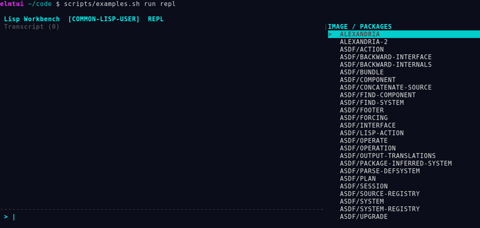
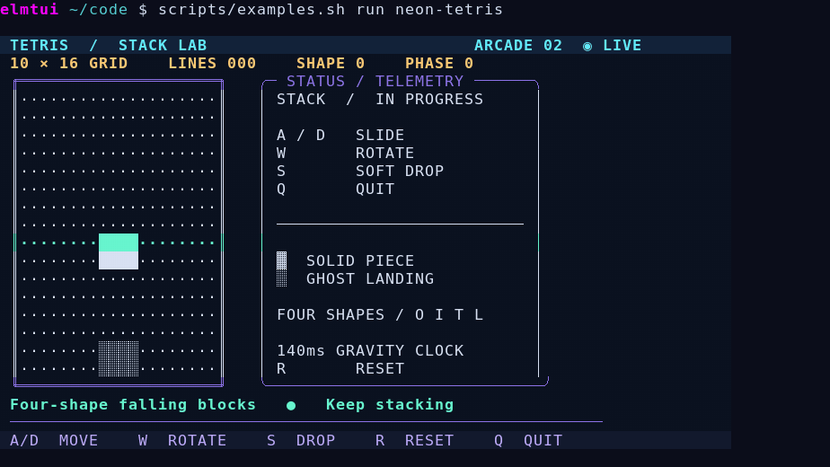
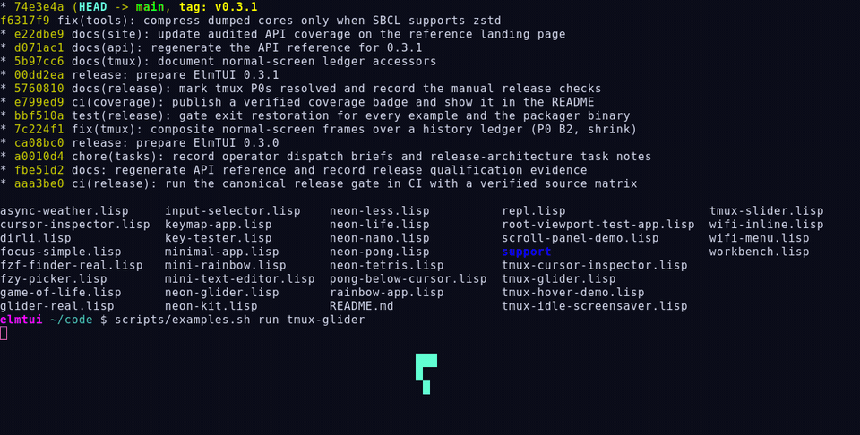

# Example gallery

Runnable example applications make the ElmTUI concepts concrete. Begin with the simple, then move to editor, games and diagnostics.

| Example | Role | Command |
|---|---|---|
| Minimal application | TEA update/view contract | `./scripts/examples.sh run minimal-app` |
| Mini text editor | Editable buffer and asynchronous saving | `./scripts/examples.sh run mini-text-editor` |
| Neon Pong | Input, animation and telemetry | `./scripts/examples.sh run neon-pong` |
| Neon Tetris | Game loop and dynamic layout | `./scripts/examples.sh run neon-tetris` |
| Neon Nano | Styled text editor with save flow | `./scripts/examples.sh run neon-nano` |
| Neon Less | Read-only file viewer | `./scripts/examples.sh run neon-less` |
| Key tester | Terminal key decoder instrumentation | `./scripts/examples.sh run key-tester` |
| Wi-Fi menu | Asynchronous external-tool integration | `./scripts/examples.sh run wifi-menu` |
| Workbench | Interactive REPL, completion, inspector | See [Workbench](workbench.md) |

The [maintained examples catalog](guide/examples-catalog.md) records keybindings, configuration variables and known limitations. Live interactive PTY behavior remains part of the release gate; an example being present is not proof of passing tests.

## Recorded sessions

These are real terminal sessions of the maintained examples, launched with `scripts/examples.sh run <name>` in urxvt and tmux and recorded with `scripts/record-demo-media.py`.

### tmux slider

  
▁ ▃ ▅ ▇ ▅ ▃ ▁ TERMINAL SLIDER / ANIMATION PREVIEW <small>website/assets/terminal-slider.gif</small>

  tmux-slider: reverse, speed up, pause

### Workbench

### neon-tetris

### tmux glider

The glider walks a Conway glider over whatever is in the tmux pane, then restores every cell and colour as it moves on.

## Example authoring standard

Every public example should have a short summary, a reproducible launch command, terminal size requirements, keybinding summary, external dependencies, cleanup behavior, and at least one automated smoke test.
